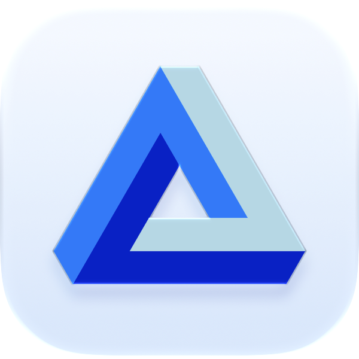
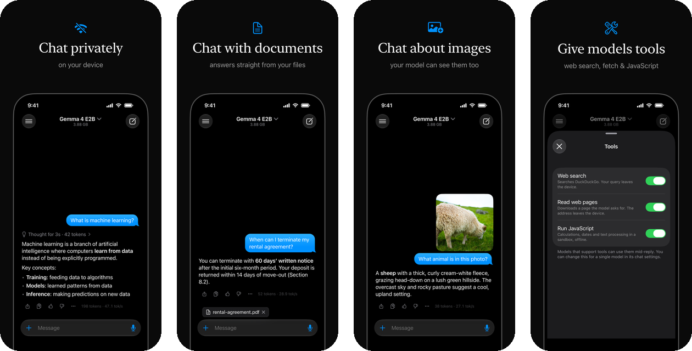
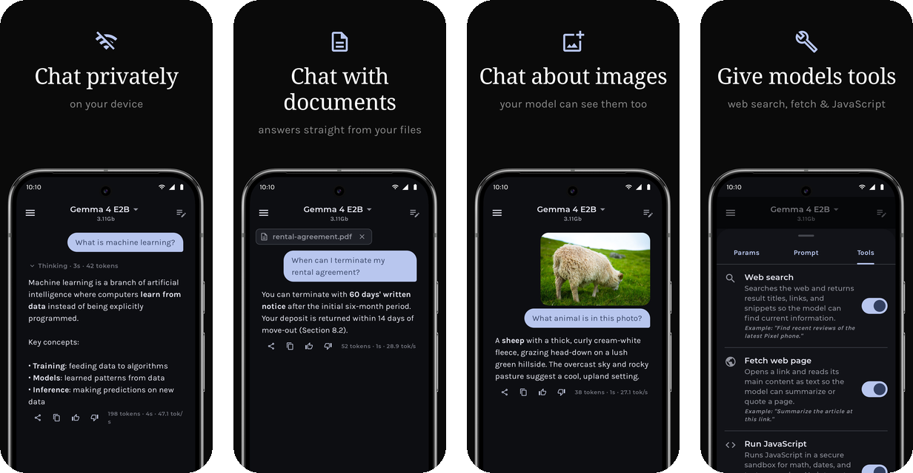

<h1 align="center">LM Playground</h1>

<p align="center">

</p>

LM Playground is an app for Android, iPhone, and iPad that runs language models locally on-device. Download models, load them in one tap, and chat - all offline, all private. Powered by [llama.cpp](https://github.com/ggml-org/llama.cpp) with GGUF-format models from [Hugging Face](https://huggingface.co/).

<p align="center">
<a href="https://play.google.com/store/apps/details?id=com.druk.lmplayground">Google Play</a> · <a href="https://apps.apple.com/app/id6837658238">App Store</a> · <a href="https://lmplayground.app/">lmplayground.app</a>
</p>

### iPhone and iPad



### Android



## Features

- **On-device inference** - no cloud, no API keys, fully offline
- **Document Q&A (RAG)** - attach PDF, Word, EPUB, HTML, Markdown, or plain-text files and ask about them; on-device semantic search with EmbeddingGemma feeds the most relevant passages to any chat model
- **Vision/image input** - attach a photo from your gallery or camera and ask vision-capable models about it (Gemma 4, Gemma 3, Qwen 3.5, Ministral 3)
- **Rich markdown** in chat responses - headers, code blocks, lists, and more
- **Reasoning model support** - thinking steps from models like GPT-OSS, DeepSeek R1, and Nemotron are displayed in a styled section
- **Tools** - capable models can search the web, fetch a page, and run JavaScript mid-reply; each tool is off by default and enabled per model
- **Reusable system prompts** - save a persona, tone, or output format once and apply it to any model
- **Edit, regenerate & branch** - long-press a message to edit and resend it, regenerate a reply, or continue from any reply in a new chat; the model's KV cache is rolled back to that point instead of re-reading the conversation
- **Voice dictation** - tap the mic and speak; on-device speech recognition in 35 languages, fully offline
- **Chat history** - conversations are saved and organized; pin, rename, delete, and resume sessions from the sidebar
- **Custom GGUF models** - load your own model files from any source alongside the built-in catalog
- **Reliable background downloads** - downloads continue in the background and resume after network interruptions (OkHttp and WorkManager on Android, background URLSession on iOS)
- **Storage management** - on Android, choose where to keep multi-GB model files with the Storage Access Framework
- **Hardware accelerated** - Metal GPU inference on iPhone and iPad; KleidiAI kernels, OpenMP, and Vulkan on Android
- **Large-screen ready** - iPad, Android tablets, foldables, and Chromebooks get a permanent sessions sidebar, list-detail Settings, and resizable windows

## Supported Models

| Family | Sizes | Provider |
|--------|-------|----------|
| GPT-OSS | 20B | OpenAI |
| Qwen 3.5 | 0.8B, 2B, 4B (all vision) | Alibaba |
| Qwen 3 | 0.6B, 1.7B, 4B | Alibaba |
| Gemma 4 | E2B, E4B (vision), 12B | Google |
| Gemma 3n | E2B, E4B | Google |
| Gemma 3 | 1B, 4B (vision) | Google |
| Nemotron 3 Nano | 4B | NVIDIA |
| Granite 4.2 | 3B | IBM |
| Granite 4.1 | 8B | IBM |
| Granite 4.0 | Micro, H-Tiny | IBM |
| DeepSeek R1 Distill | 1.5B, 7B | DeepSeek |
| Phi-4 mini | 3.8B | Microsoft |
| LFM2.5 | 350M, 1.2B Thinking, 2.6B | Liquid AI |
| LFM2.5 VL | 450M, 1.6B, 3B (vision) | Liquid AI |
| LFM3 | 1.7B, Omni 2B (vision) | Liquid AI |
| SmolLM3 | 3B | Hugging Face |
| MiniCPM5 | 1B, 2B | OpenBMB |
| Spark-X2.6 | 4B | XHToken |
| Ministral 3 | 3B, 8B (Instruct & Reasoning, all vision) | Mistral |
| Llama 3.2 | 1B, 3B | Meta |
| Llama 3.1 | 8B | Meta |

<details>
<summary>Legacy models</summary>

| Family | Sizes | Provider |
|--------|-------|----------|
| Qwen 2.5 | 0.5B, 1.5B | Alibaba |
| Phi 3.5 mini | 3.8B | Microsoft |
| Mistral v0.3 | 7B | Mistral |
| Gemma 2 | 9B | Google |

</details>

Most models use Q4_K_M quantization; Qwen 3.5 uses Q3_K_M, and GPT-OSS ships in its native MXFP4 format. See [`ModelInfoProvider.kt`](android/app/src/main/java/com/druk/lmplayground/models/ModelInfoProvider.kt) for the full list. On iPhone and iPad, the app checks each model against the device's GPU memory before loading it, so the largest models need a device with enough memory.

## Install

If you're just looking to install LM Playground:

- **Android** - [Google Play](https://play.google.com/store/apps/details?id=com.druk.lmplayground)
- **iPhone and iPad** - [App Store](https://apps.apple.com/app/id6837658238); needs iOS 26 or later and an iPhone 15 Pro or newer, or an iPad with an M1 chip or newer

If you're a developer wanting to contribute, read on.

## Repository layout

| Folder | Contents |
|--------|----------|
| [`android/`](android/) | The Android app (Gradle project). See [`android/ARCHITECTURE.md`](android/ARCHITECTURE.md). |
| [`ios/`](ios/) | The iPhone and iPad app (SwiftUI; Xcode project generated from [`project.yml`](ios/project.yml) with XcodeGen). |
| [`core/`](core/) | The C++ engine shared by both apps, and the llama.cpp submodule. |
| [`docs/`](docs/) | The website. |

## Build Instructions

Clone the repository with submodules:
```
git clone --recurse-submodules https://github.com/andriydruk/LMPlayground.git
```

### Android

Prerequisites:
* Android Studio [2024.3.1+](https://developer.android.com/studio/releases)
* NDK 27.2.12479018
* CMake 3.31.6

1. Open the Android project in Android Studio: `File` > `Open` > select the `android/` folder of the cloned repository.
2. Connect an Android device or start an emulator.
3. Run the application using `Run` > `Run 'app'` or the play button in Android Studio.

### iPhone and iPad

Prerequisites:
* Xcode 26+
* CMake

1. Build the llama.cpp engine as an XCFramework (once, and again after the submodule changes):
```
ios/scripts/build-xcframework.sh
```
2. Open `ios/LMPlayground.xcodeproj` in Xcode and select the `LMPlayground` scheme.
3. Run it on an iPhone or iPad. The simulator works too, but inference runs on the CPU there.

## License

This project is licensed under the [MIT License](LICENSE).

## Acknowledgments

This project is built on [llama.cpp](https://github.com/ggml-org/llama.cpp). Models are GGUF-format, mostly Q4_K_M quantization, sourced from [Hugging Face](https://huggingface.co/).

## Contact

If you have any questions, suggestions, or issues, feel free to open an issue or contact me directly at [me@andriydruk.com](mailto:me@andriydruk.com).
